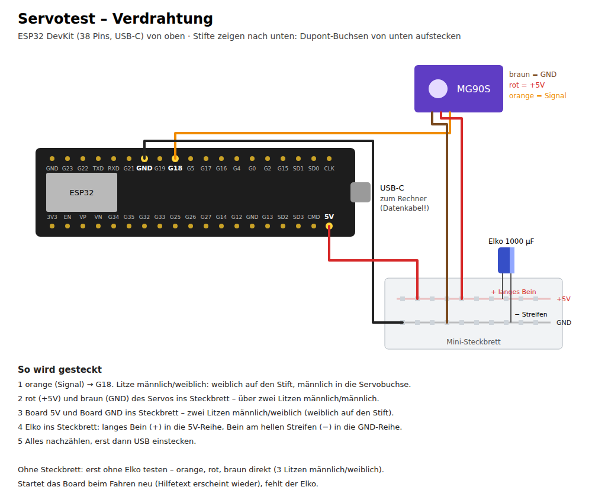

# Testanleitung: Servo am Prüfstück

Ziel: sehen, ob das Servo den Riegel sauber durch die Zunge schiebt und wieder
zurückholt – bevor die große Kiste gedruckt wird. Dauer: etwa eine Stunde,
die meiste Zeit für das Einrichten der Arduino-IDE.

Du testest in zwei Stufen: erst **ohne Strom** (passt alles, läuft es von
Hand?), dann **mit Strom** (fährt das Servo die Endlagen, hält es 20 Zyklen
durch?). Die zweite Stufe nur, wenn die erste sauber war.

## Was du brauchst

| | |
|---|---|
| Prüfstück | die aktuelle Fassung (ab 14. 10.: Servotasche 23 mm lang mit 0,8 mm Spiel, Schlitz für den Kabelansatz) |
| Servo MG90S | mit dem **einarmigen Horn** und dem kleinen Wellenschräubchen |
| M2-Schraube, 10–14 mm | der Stift; dazu ein **1,6-mm-Bohrer** |
| ESP32 DevKit | mit angelöteten Stiftleisten |
| USB-**Daten**kabel | kein reines Ladekabel – häufigster Grund, wenn der Rechner nichts erkennt |
| Dupont-Litzen | 3× männlich/weiblich, 2× männlich/männlich |
| Mini-Steckbrett | das kleinste genügt – dort treffen sich 5V, GND, Servo und Elko |
| Elko 1000 µF, ≥ 6,3 V | steckt im Steckbrett |
| Rechner | mit der Arduino-IDE 2 |

## Stufe 1 – ohne Strom

1. **Riegel und Zunge prüfen.** Riegel von oben in die Rinne legen und nach
   rechts in den Tunnel schieben: Er soll fast unter seinem Gewicht gleiten.
   Zunge mit der Schulter auf den Block setzen: Sie soll ohne Kraft
   hineinfallen. Hakt etwas, die Unterkanten des Riegels mit Cutter oder
   Schleifpapier brechen und die Gleitflächen mit Bleistift schwärzen.
2. **Horn vorbereiten.** Das äußerste Loch des einarmigen Horns (16 mm von der
   Mitte) mit 1,6 mm aufbohren. M2-Schraube von oben eindrehen, bis der Kopf
   aufliegt – sie schneidet ihr Gewinde selbst. Ein Tropfen Sekundenkleber
   sichert sie.
3. **Servo einsetzen.** Stecker und Kabel von oben in den Kanal links neben
   der Tasche legen. Dann das Servo **gerade von oben** einsetzen: Der
   abstehende Kabelansatz gleitet durch den senkrechten Schlitz in der
   linken Laschenstufe mit nach unten – hebeln muss man nichts mehr (am
   ersten Prüfstück musste man; die Tasche war 1 mm zu kurz und die Stufe
   über dem Kabel geschlossen). Die Tasche hat ringsum 0,8 mm Spiel: Für den
   Test **nicht kleben** – drück es mit dem Daumen auf die Stufe. In der
   großen Kiste wird es erst geklebt, wenn es am Riegel ausgerichtet ist.
4. **Riegel so legen, dass die Spitze mitten im Zungenschlitz steht.** Dann
   liegt sein Querschlitz unter der Stelle, wo der Stift in Mittelstellung
   ankommt.
5. **Horn aufstecken**, der Arm zeigt quer zum Riegel, der Stift fällt in den
   Querschlitz. Noch nicht festschrauben.
6. **Sanft von Hand drehen**, gut 20° in jede Richtung (nicht weiter – dann
   läuft der Stift aus dem Schlitz). Der Riegel muss mitlaufen, ohne zu haken:
   in die eine Richtung durch die Zunge hindurch, in die andere so weit
   zurück, dass sich die Zunge frei abheben lässt.

**Wenn es hier schon klemmt:** aufhören und berichten, wo – mit Strom wird es
nicht besser, und ein Servo, das gegen einen Widerstand drückt, stirbt.

## Stufe 2 – mit Strom

### Arduino-IDE einrichten (einmalig)

1. [Arduino-IDE 2](https://www.arduino.cc/en/software) installieren.
2. **Werkzeuge → Board → Boardverwalter**, nach „esp32" suchen, das Paket
   **„esp32 by Espressif Systems"** installieren (gut 200 MB).
3. **Werkzeuge → Bibliotheken verwalten**, nach „ESP32Servo" suchen,
   **„ESP32Servo"** installieren.
4. ESP32 per USB anstecken. **Werkzeuge → Board → ESP32 → „ESP32 Dev
   Module"**, unter **Werkzeuge → Port** den neuen Eintrag wählen
   (Windows: COM3 o. ä., Mac: `/dev/cu.usbserial-…` oder `cu.SLAB…`).

Erscheint kein Port: anderes Kabel probieren (Datenkabel!). Steht auf dem Board
ein Chip „CH340", braucht macOS/Windows evtl. dessen Treiber; „CP2102" geht
meist ohne.

### Verdrahten – ohne USB

Das Board hat **nur einen 5V-Pin**. An ihm müssen Servo und Elko hängen – zwei
Buchsen passen aber nicht auf einen Stift. Deshalb treffen sich 5V und GND auf
einem **Mini-Steckbrett**:

| Von | Nach | Litze |
|---|---|---|
| Servo orange (Signal) | **GPIO 18** (Beschriftung „G18", „D18" oder „18") | männlich/weiblich |
| Servo rot (Plus) | Steckbrett, Reihe **+5V** | männlich/männlich |
| Servo braun (Minus) | Steckbrett, Reihe **GND** | männlich/männlich |
| Board **5V** (auf manchen Boards „VIN") | Steckbrett, Reihe +5V | männlich/weiblich |
| Board **GND** (einer der drei) | Steckbrett, Reihe GND | männlich/weiblich |

Weibliche Enden kommen auf die Boardstifte – die zeigen nach unten, also von
unten aufstecken. Männliche Enden in die Servobuchse und ins Steckbrett.

Den **Elko** ins Steckbrett: **langes Bein in die +5V-Reihe**, das Bein an der
Seite mit dem hellen Streifen (Minus) in die GND-Reihe. Verpolt kann er
platzen. Einmal alles nachzählen, dann erst USB anstecken.

**Ohne Steckbrett** geht der erste Test auch ohne Elko: orange an G18, rot an
5V, braun an GND, je eine Litze männlich/weiblich. Für ein paar Fahrten ohne
Last reicht das meist. Startet das Board beim Anfahren neu, fehlt der Elko.

Der Plan wird aus `servotest/schaltplan.py` erzeugt (`python3 schaltplan.py`).

### Aufspielen

`servotest/servotest.ino` öffnen, **Hochladen** (Pfeil oben links). Bleibt
die Ausgabe bei `Connecting....` hängen: die Taste **BOOT** auf dem Board
gedrückt halten, bis das Hochladen losgeht.

Dann **Werkzeuge → Serieller Monitor**, unten **115200 Baud** und **„Neue
Zeile"** einstellen. Es erscheint die Hilfe des Testprogramms.

### Testablauf

| # | Eingabe | Was passieren soll |
|---|---|---|
| 1 | Horn **abnehmen**, dann `m` | Servo fährt in die Mitte (90°). |
| 2 | – | Riegel wieder mit der Spitze mitten in den Zungenschlitz, **Horn aufstecken**, Stift in den Querschlitz. Sitzt es einen Zahn schief, abziehen und neu aufsetzen. Dann das **Wellenschräubchen** eindrehen. |
| 3 | `z` | Der Riegel fährt durch das Loch der Zunge. Fährt er stattdessen zurück: im Programm `RICHTUNG = -1`, neu hochladen. |
| 4 | – | Versuch, die Zunge an der Schulter hochzuziehen: **Sie muss halten.** |
| 5 | `a` | Der Riegel fährt zurück, die Zunge lässt sich **frei abheben**. |
| 6 | `+` / `-` oder Zahl + Enter | Endlagen fein einstellen: zu – die Spitze steht gut 3 mm hinter der Zunge; auf – die Zunge geht frei, ohne dass der Stift am Schlitzende anstößt. Gefundene Winkel notieren (`p` zeigt sie). |
| 7 | `d` | 20 Zyklen zu und auf. Zuschauen und hinhören. |

**Worauf achten:**

- **Brummen in einer Endlage:** Das Servo drückt gegen einen Anschlag. Diese
  Endlage ein, zwei Grad zurücknehmen.
- **Ruckeln oder Stocken unterwegs:** Reibung im Tunnel oder der Stift
  streift am Schlitz – Stelle merken.
- **Die Hilfe erscheint plötzlich neu:** Das Board ist neu gestartet, weil die
  Spannung beim Anfahren einbricht. Elko-Sitz prüfen (oder ihn nachrüsten), anderes USB-Netzteil
  oder einen anderen USB-Port (mindestens 1 A).
- **Servo wird warm:** Es arbeitet gegen eine Klemmung. Sofort `m`, USB ab.

## Zurückmelden

Damit die Kiste stimmt, brauche ich:

1. Lief der Riegel in Stufe 1 von Hand sauber? Wenn nicht: wo hakt es?
2. Die Winkel der beiden Endlagen aus Schritt 6 (z. B. „zu 113, auf 67").
3. Hielt die Zunge in Schritt 4?
4. Lief der Dauertest durch – ohne Brummen, Neustart, Wärme?
5. Wenn möglich ein Foto von oben in beiden Endlagen.
